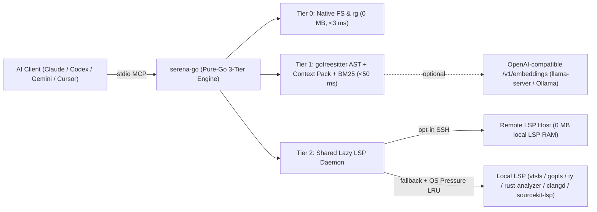

# serena-go

**Zero-Python, `CGO_ENABLED=0` Pure-Go 3-Tier Code-Intelligence MCP Server** — a fast, ultra-low-memory, drop-in Serena-compatible MCP engine for AI coding agents (Claude Code, Codex, Gemini CLI, Cursor, Windsurf, Zed).

- **18 concurrent agent sessions ≈ 33 MB total RAM** (~0.6–7 MB per process vs. hundreds of MB per Python session)
- **Instant AST & 1-Shot Context Packs** (`<2 ms` Tier 0 FS, `<50 ms` Tier 1 `gotreesitter` AST, `~120 ms` `code_context_pack`)
- **Shared Lazy LSP Daemons** with OS memory-pressure LRU governance (macOS `memorystatus` + Linux `/proc/meminfo`) and optional **SSH Remote LSP Offload** (`0 MB` local LSP RAM)
- **Hybrid Semantic Code Search** — local AST-chunked BM25 out of the box, seamlessly upgrading to **BM25 + GPU Vector Reciprocal Rank Fusion (RRF)** whenever an OpenAI-compatible `/v1/embeddings` endpoint (`llama-server`, Ollama, vLLM) is reachable
- **~50% smaller MCP tool schema** (`~12.5 KB`) to preserve agent context windows

> **Disclaimer:** `serena-go` is an independent Pure-Go implementation designed to be drop-in compatible with the Serena MCP tool protocol and `.serena/memories/` layout. It is not affiliated with or endorsed by Oraios.

---

## Architecture



See [docs/architecture.md](docs/architecture.md) for full internals.

---

## Live Benchmarks

Measured on Apple M4 (16 GB RAM) against real Go (8,299 AST chunks) and Go/TypeScript (12,226 AST chunks) repositories:

| Operation | Engine Tier | Latency | Local LSP RAM |
|---|---|---|---|
| `initialize` + `tools/list` | Native Go | `~8 ms` | `0 MB` |
| `list_memories` | Tier 0 FS | `1.9 ms` | `0 MB` |
| `get_symbols_overview` (47 symbols) | Tier 1 `gotreesitter` AST | `46.6 ms` | `0 MB` |
| `code_context_pack` (body + imports + callers + diags) | Tier 1+ | `121.1 ms` | `0 MB` |
| `semantic_code_search` (12,226 chunks, warm Hybrid GPU RRF) | Tier 1 + `nomic-embed-text` | `195.1 ms` | `0 MB` |
| `find_referencing_symbols` (remote `gopls`, warm) | Tier 2 Remote LSP | `31.7 ms` | `0 MB` |
| `serena-go check-file` (AST + `oxlint` on broken TS) | Post-edit hook | `116.0 ms` | `0 MB` |
| 18 concurrent MCP sessions | Native Go | — | **~33 MB total** |

---

## Quickstart

### 1. Install

**Option A — `go install` (Go 1.24+):**
```bash
go install github.com/aklkbqx/serena-go@latest
```

**Option B — Prebuilt static binaries:**
Download the tarball for your platform (`darwin/arm64`, `darwin/amd64`, `linux/amd64`, `linux/arm64`) from [Releases](https://github.com/aklkbqx/serena-go/releases) and place `serena-go` on your `PATH`.

**Option C — Drop-in replacement for existing `serena` configs:**
```bash
ln -sf "$(command -v serena-go)" ~/.local/bin/serena
```

### 2. Verify Your Environment

```bash
serena-go doctor
```

Install optional local language servers / linters only for the languages you use:
- **TypeScript / JavaScript:** `@vtsls/language-server` (LSP), `oxlint` (fast hook linter)
- **Go:** `gopls`
- **Python:** `ty` (Astral LSP + fast hook checker) or `basedpyright`
- **Rust:** `rust-analyzer`
- **C / C++:** `clangd` · **Swift:** `sourcekit-lsp`

### 3. Wire into Your AI Client

**Claude Code (`~/.claude.json` or `.mcp.json`):**
```json
{
  "mcpServers": {
    "serena": {
      "command": "serena-go",
      "args": ["start-mcp-server", "--project", "/path/to/repo"]
    }
  }
}
```

**Cursor / Windsurf (`mcp.json`):**
```json
{
  "mcpServers": {
    "serena": {
      "command": "serena-go",
      "args": ["start-mcp-server", "--project", "${workspaceFolder}"]
    }
  }
}
```

**Codex (`~/.codex/config.toml`):**
```toml
[mcp_servers.serena]
command = "serena-go"
args = ["start-mcp-server"]
```

---

## CLI Commands

| Command | Purpose |
|---|---|
| `serena-go start-mcp-server [--project <dir>]` | Start stdio MCP server |
| `serena-go check-file <path>` | Instant `<120 ms` AST + `oxlint`/`ty` + warm-LSP diagnostics (ideal for `PostToolUse` hooks; 0 output when clean) |
| `serena-go doctor` | Check AST engine, local LSPs, remote offload, embeddings, and OS memory pressure policy |
| `serena-go status` | List active shared LSP daemons (PID, host, idle age, repo) |
| `serena-go stop-lsp` | Gracefully shut down all active shared LSP daemons |
| `serena-go version` | Print version, commit, and target OS/arch |

---

## MCP Tool Reference (24 Tools)

| Tier | Tools | Runtime Cost |
|---|---|---|
| **Tier 0 (Native FS / `rg`)** | `initial_instructions`, `onboarding`, `list_memories`, `read_memory`, `write_memory`, `edit_memory`, `delete_memory`, `rename_memory`, `search_for_pattern`, `replace_content`, `replace_in_files` | `0 MB`, `<3 ms` |
| **Tier 1 (`gotreesitter` AST & Search)** | `code_context_pack`, `semantic_code_search`, `get_symbols_overview`, `find_symbol`, `replace_symbol_body`, `insert_before_symbol`, `insert_after_symbol` | `0 MB` idle, `<50 ms` |
| **Tier 2 (Lazy Shared / Remote LSP)** | `find_referencing_symbols`, `find_declaration`, `find_implementations`, `rename_symbol`, `get_diagnostics_for_file`, `safe_delete_symbol` | Lazy per `(repo, lang)`, shared across agents, LRU + pressure governed |

---

## Configuration

`serena-go` works with **zero configuration** out of the box (local AST + local lazy LSP + local AST-BM25 search).

To customize optional features without polluting MCP client configs, create `~/.config/serena-go/config.json` (or set `SERENA_CONFIG`):

```json
{
  "remote_lsp": {
    "mode": "auto",
    "host": "build-box",
    "probe_addr": "192.0.2.10:22",
    "root_prefix": "/srv/work"
  },
  "embeddings": {
    "url": "http://127.0.0.1:18081/v1/embeddings",
    "model": "nomic-embed-text"
  }
}
```

Environment variables always override `config.json`:
- `SERENA_MAX_LSPS` (default `2`) / `SERENA_LSP_IDLE_SECS` (default `180`)
- `SERENA_REMOTE_LSP` (`auto` | `off` | `force`), `SERENA_REMOTE_LSP_HOST`, `SERENA_REMOTE_LSP_PROBE_ADDR`, `SERENA_REMOTE_LSP_ROOT_PREFIX`, `SERENA_REMOTE_LSP_ROOT`
- `SERENA_EMBED_URL` (OpenAI-compatible `/v1/embeddings` URL or `off`), `SERENA_EMBED_MODEL`
- `SERENA_ENGINE=legacy` (optional escape hatch to delegate to an existing Python `serena-agent` binary)

Deep-dive guides:
- [Optional SSH Remote LSP Offload](docs/remote-lsp.md)
- [Optional Hybrid GPU Semantic Search](docs/hybrid-gpu-search.md)

---

## Platform Support

- **macOS** (`arm64`, `amd64`) — native `kern.memorystatus_vm_pressure_level` governance
- **Linux** (`amd64`, `arm64`) — native `/proc/meminfo` memory-pressure governance
- **Windows** — supported via **WSL2** (Unix domain socket + POSIX process groups)

---

## License

[MIT](LICENSE)
